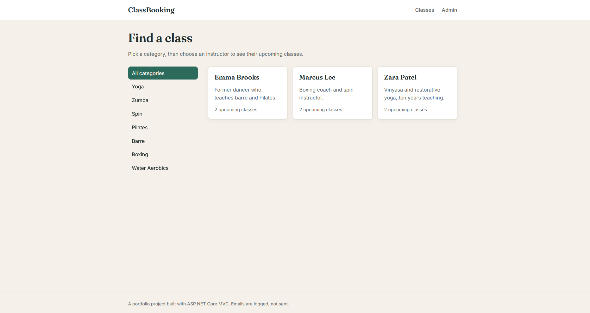
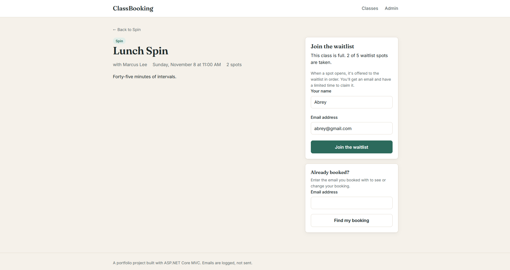
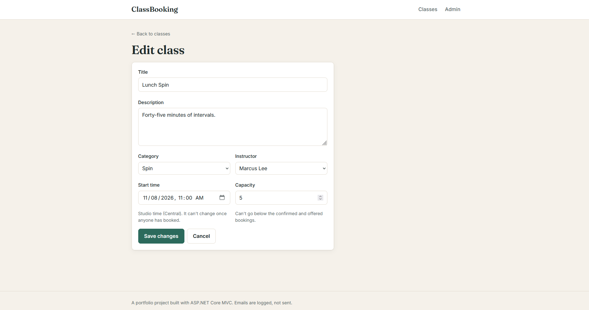
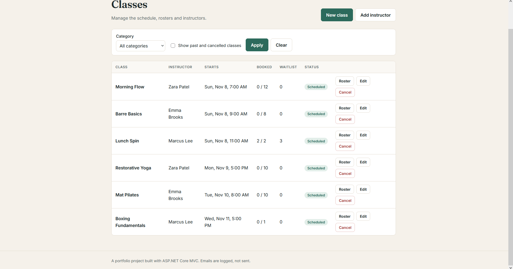
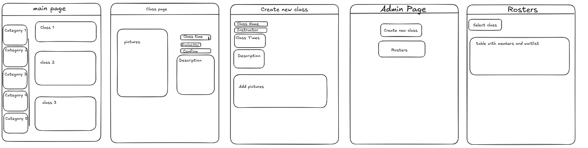

# ClassBooking


A booking app for a fitness studio, built with ASP.NET Core MVC, Entity Framework Core and SQL Server. Members book classes or join a waitlist, and when a spot opens, the next person in line gets a time-limited hold to claim it. Admins manage the schedule, capacity and rosters. There's also a small REST API for the same data.

## Screenshots






## Features

**Members**
- Browse classes by category and instructor
- Filter an instructor's classes by category, start date and open spots
- Book a class, or join the waitlist when it's full
- Find a booking by email, then cancel it or claim an offered spot

**Admins**
- Create, edit and cancel classes
- Change capacity, which automatically offers new spots to the waitlist
- View rosters split into confirmed, holding an offer, and waitlist in line order
- Add instructors

**Background job**
- Runs every minute to expire unclaimed holds and offer those spots to the next person in line
- One hour before class, emails everyone still waiting, clears the waitlist and opens the spots to anyone

## Booking rules

I wrote these out before writing any code, and every one of them is covered by tests.

1. If a spot is open and nobody is waiting, a booking is confirmed right away.
2. If the class is full, members can join a waitlist of up to 5 people, first come first served.
3. An email can only hold one active booking per class.
4. Sign-up closes 5 minutes before the class starts.
5. Confirmed bookings can't be cancelled within an hour of the class.
6. When a spot opens, the first person on the waitlist is offered it and gets an email. The spot is held for 6 hours or until one hour before class, whichever comes first.
7. If a hold runs out, that booking expires and the spot is offered to the next person.
8. One hour before class, everyone still waiting is emailed, the waitlist is cleared, and any open spots go to whoever books first.
9. Capacity can't go below the number of confirmed and offered bookings. Raising it offers the new spots to the waitlist.
10. A class's start time can't change once anyone has booked, and a class can't be edited or cancelled after it starts.
11. Cancelling a class cancels every active booking and emails each person.
12. Cancelled and expired bookings are kept for history instead of being deleted.

## Design

I sketched the main screens before building anything. The finished app grew a few pages the sketches didn't have, mainly the instructor page, manage booking and add instructor, once the rules made it clear they were needed.



## Architecture

```
ClassBooking.Core    entities and all booking rules, no framework or database dependencies
ClassBooking.Web     MVC controllers and views, EF Core, background job, REST API
ClassBooking.Tests   xUnit tests against Core only
```

A few decisions worth explaining:

- **Rules live on the entities.** `FitnessClass` has methods like `Book`, `CancelBooking`, `ClaimOffer` and `ProcessExpiredHolds`, and private setters mean state can only change through them. Controllers load data, call Core, save and redirect. They never decide anything themselves.
- **The current time is passed in.** Rule methods take `now` as a parameter instead of reading the clock, so tests can check every cutoff at its exact boundary.
- **Rules return notifications instead of sending them.** Core decides who should be emailed and what it says. Web saves to the database first, then sends, so nobody gets an email about a change that failed to save.
- **Times are stored in UTC.** The website shows studio time (Central) and the API returns UTC.
- **View models and DTOs are separate.** Pages get view models shaped for one page, and the API gets DTOs that act as a stable contract. Entities never go straight to a view or the API.

## Running it locally

**You'll need:** Visual Studio 2026 with the ASP.NET and web development workload, and SQL Server Express LocalDB. The .NET 10 SDK with LocalDB works too.

1. Clone the repo and open `ClassBooking.slnx`.
2. Run `ClassBooking.Web`.

On first run, the database is created, migrations are applied and sample data is seeded automatically. The sample data includes a full class with a waitlist and an expired hold, so you can watch the background job pick it up in the console within a minute.

The admin pages are at `/Admin`.

## Running the tests

Use Test Explorer in Visual Studio, or run this from the repo root:

```
dotnet test
```

The tests only touch Core, so they don't need a database. GitHub Actions runs them on every push and pull request.

## REST API

| Method | Route | Description |
|---|---|---|
| GET | `/api/classes` | Upcoming classes. Optional `category`, `from` (UTC) and `onlyOpen` query parameters |
| GET | `/api/classes/{id}` | One class |
| POST | `/api/classes/{id}/bookings` | Book a class |

Booking returns `201 Created` with the booking, `400` for invalid input, `404` if the class doesn't exist, or `409 Conflict` with a ProblemDetails body when a rule refuses it.

```
POST /api/classes/1/bookings
Content-Type: application/json

{
  "memberName": "Sam Cole",
  "memberEmail": "sam@example.com"
}
```

`ClassBooking.Web/ClassBooking.Web.http` has ready-made requests you can send from Visual Studio.

## Known limitations

- **No authentication.** Admin pages are open to anyone. A real version would put them behind a login with an admin role.
- **Start time is locked once people book.** A real system would let the time change and email everyone booked, probably waiving the one-hour cancel cutoff for them.
- **Last save wins.** If the background job and a member change the same class at the same moment, the second save overwrites the first. An EF Core concurrency token would make the second save fail instead.
- **Emails are logged, not sent.** Notifications go through an `INotificationService` interface, so swapping in real email means one new class and one line in `Program.cs`.
